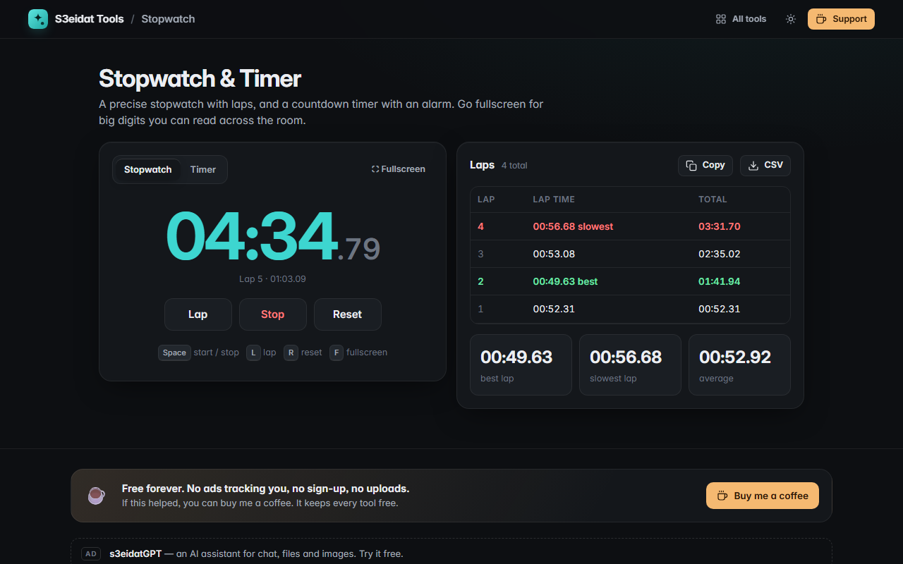

# Stopwatch & Timer

> A precise stopwatch with laps and a countdown timer with an alarm. Free, private, and it runs entirely in your browser.

### ▶ [Open Stopwatch & Timer](https://s3eidat.github.io/stopwatch/)



## Features

- **Stopwatch** to the hundredth of a second, with **laps**: best lap in green, slowest in red, average
- Export laps as **CSV** (copy or download)
- **Countdown timer** with presets (1, 3, 5, 10, 15, 25 min, 1 h) or any hours/minutes/seconds, progress bar and end time
- **Alarm** beeps for up to 30 seconds when the timer ends (or stop it with Space/Esc); the tab title shows the time
- **Fullscreen** big-digit mode you can read across the room
- **Accurate**: time is computed from the clock, so it stays right in background tabs and survives a reload
- Keyboard: <kbd>Space</kbd> start/stop, <kbd>L</kbd> lap, <kbd>R</kbd> reset, <kbd>F</kbd> fullscreen

## Privacy

Laps and settings are saved only in your browser (localStorage). There is no server, no account, no analytics.
The page ships with a strict Content-Security-Policy (`connect-src 'self'`), so the browser
itself blocks any attempt to send data anywhere.

## Run it yourself

It's plain HTML, CSS and JavaScript with no build step:

```bash
git clone https://github.com/s3eidat/stopwatch
cd stopwatch
python -m http.server 8000
```

Then open http://localhost:8000.

## Support

If this saved you time, **[buy me a coffee ☕](https://s3eidat.github.io/coffee/)**. It keeps every tool free.

---

Part of **[S3eidat Tools](https://s3eidat.github.io/)**: 100+ free, private tools that run in your browser. MIT licensed.
